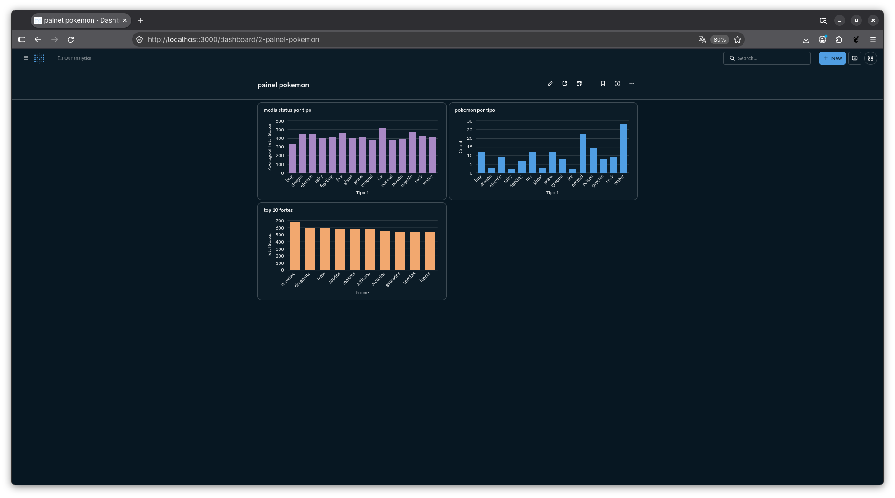

# Painel Pokémon

Pipeline de dados que busca os 151 primeiros Pokémon na PokéAPI, trata os dados com Python e grava em um PostgreSQL. Os dados são exibidos em um dashboard no Metabase.

## Fluxo

PokéAPI -> Python (requests, pandas) -> PostgreSQL -> Metabase

## Tecnologias

- Python
- Pandas e SQLAlchemy
- PostgreSQL
- Metabase
- Docker Compose

## Como rodar

Subir o banco e o Metabase:

    docker compose up -d

Criar o ambiente e instalar as bibliotecas:

    python3 -m venv .venv
    source .venv/bin/activate
    pip install -r requirements.txt

Rodar o pipeline:

    python pipeline.py

Abrir o Metabase em http://localhost:3000 e conectar no PostgreSQL com host `postgres`, porta `5432`, banco `pokemon`, usuário `admin` e senha `admin`.
